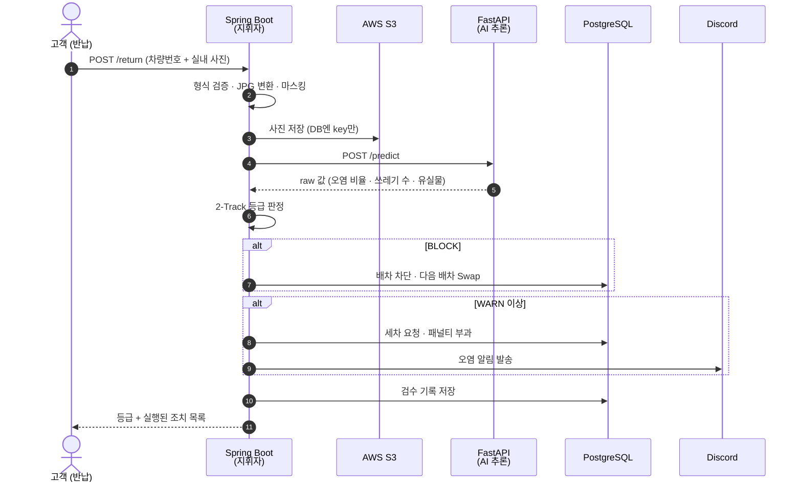
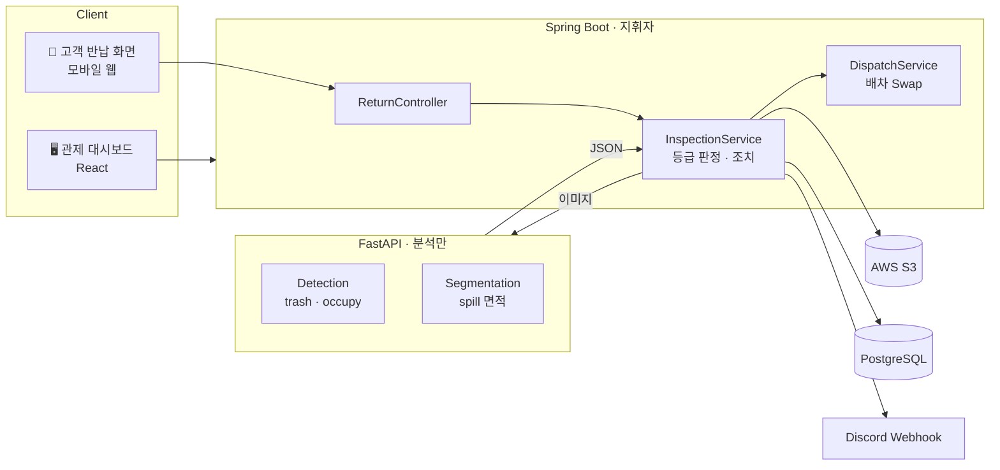
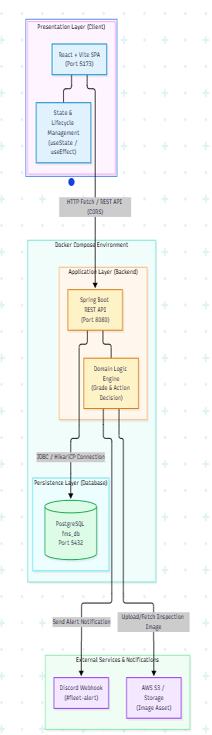
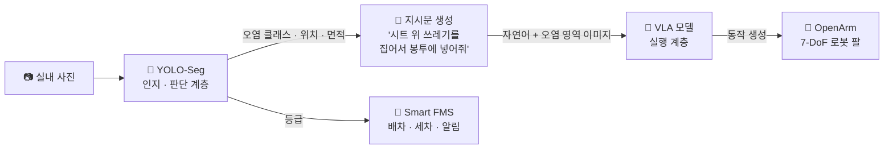

<p align="center">
  
</p>

<h1 align="center">🚗 Smart FMS — AI 기반 차량 실내 오염 탐지 · 자동 배차 관제 시스템</h1>

<p align="center">
  다음 승객이 문을 열기 전에, AI가 실내 오염을 판정하고 <b>배차 차단 · 세차 호출 · 패널티 · 알림</b>까지 사람 개입 없이 처리하는 무인 FMS
</p>

<p align="center">
  🏆 <b>2026 AI-Powered SW상상기업 우수상</b> &nbsp;|&nbsp; SW상상기업 6기 · 팀 <b>EVIDA</b> (2026.02 ~ 2026.09)
</p>

<p align="center">
  
  
  
  
  
  <br/>
  
  
  
  
</p>

---

## 📌 목차

1. [기획 배경](#-기획-배경--문제-정의)
2. [기획 히스토리 — 주제 피벗](#-기획-히스토리--주제-피벗)
3. [핵심 컨셉](#-핵심-컨셉)
4. [서비스 흐름](#-서비스-흐름)
5. [2-Track 오염 등급 판정](#️-2-track-오염-등급-판정)
6. [시스템 아키텍처](#️-시스템-아키텍처)
7. [AI 모델](#-ai-모델)
8. [API](#-api)
9. [설계 포인트](#-설계-포인트)
10. [확장 비전 — 물리적 정리까지](#-확장-비전--물리적-정리까지)
11. [레포 구조](#-레포-구조)
12. [실행 방법](#-실행-방법)
13. [협업 방식](#-협업-방식)
14. [팀원](#-팀원)

---

## 🚨 기획 배경 · 문제 정의

> **"차는 무인화됐는데, 실내 관리는 여전히 사람 눈에 의존한다."**

카셰어링·무인 모빌리티가 확산되면서 차량 반납은 비대면이 됐지만, 실내 상태 확인은 다음 이용자의 신고나 현장 점검에 맡겨져 있습니다.

| 문제 | 현황 |
|---|---|
| 🧹 실내 오염 방치 | 다음 이용자가 오염된 차량을 그대로 배정받음 |
| 🕵️ 책임 소재 불분명 | 누가 언제 더럽혔는지 객관적 근거 부재 |
| 🧾 수작업 운영 | 오염 확인 → 배차 조정 → 세차 요청을 사람이 처리 |
| 👜 유실물 | 소지품 분실 시 직전 이용자 특정이 어려움 |

👉 **반납 순간 AI가 실내를 판정하고, 그 결과를 운영 액션까지 자동으로 연결하는 B2B 관제 시스템**이 필요합니다.

---

## 🔄 기획 히스토리 — 주제 피벗

이 프로젝트는 처음부터 Smart FMS가 아니었습니다.

| 시점 | 내용 |
|---|---|
| 초기 | 세무 증빙 지출 리스크 관리 서비스로 시작 |
| 중간 발표 | "범용 생성형 AI로 대체 가능하다"는 피드백 |
| **피벗** | 남은 기간 약 3개월, 대체 기획안 3건을 작성·발표해 팀 합의로 주제 전환 |
| 결과 | 무인 모빌리티의 **실내 관리 공백**에서 문제를 다시 정의 → 단순 탐지를 넘어 **B2B 관제 시스템**으로 확장 → 우수상 수상 |

> 💡 판단 기준은 하나였습니다. **"범용 AI가 대신할 수 없는, 도메인 데이터와 운영 자동화가 결합된 문제인가?"**

---

## 💡 핵심 컨셉

| | 기존 방식 | **Smart FMS** |
|---|---|---|
| 판정 방식 | BBox로 "있다/없다" | **세그멘테이션으로 오염 면적(%) 정량화** |
| AI의 역할 | 탐지에서 끝 | **오염도 → 배차·세차·패널티·알림까지 자동화** |
| 판정 기준 | 사람의 주관 | **설정값으로 분리된 운영 정책 파라미터** |
| 개인정보 | 원본 사진 저장 | **얼굴·번호판 마스킹 후 저장 설계** |

---

## 🧭 서비스 흐름



---

## ⚖️ 2-Track 오염 등급 판정

> AI는 **raw 값만** 반환하고, **판정은 백엔드가** 합니다. 성격이 다른 두 신호를 독립 평가 후 더 심각한 쪽으로 통합(Overriding)합니다.

| Track | 입력 | `BLOCK` | `WARN` | `NORMAL` |
|---|---|---|---|---|
| 🗑️ **Track 1 · 쓰레기** | 개수 · 크기 (Detection) | 대형 1개↑ 또는 3개↑ | 1~2개 | 없음 |
| 💧 **Track 2 · 오염** | ROI 대비 면적 비율 (Segmentation) | 5% 이상 | 2~5% | 2% 미만 (반사·노이즈 마진) |

| 최종 등급 | 자동 조치 |
|---|---|
| 🚨 `BLOCK` | 배차 차단 + 다음 배차 Swap + 세차 호출 + 패널티 10점 + 알림 |
| ⚠️ `WARN` | 세차 호출 + 패널티 5점 + 알림 |
| ✅ `NORMAL` | 운행 가능 상태 유지 |
| 👜 유실물 감지 | 등급과 별개로 직전 이용자에게 알림 |

> 임계치(5% · 2% · 3개)는 학술값이 아닌 **운영 정책 파라미터**입니다. 운영사가 비용·고객경험에 맞춰 조정할 수 있도록 하드코딩하지 않고 `application.yml` 설정값으로 분리했습니다.

---

## 🏗️ 시스템 아키텍처



<details>
<summary><b>🐳 배포 구성 (Docker Compose 기준 3-Tier)</b></summary>
<br/>
<p align="center">
  
</p>
</details>

| 레이어 | 기술 |
|---|---|
| **AI / CV** | YOLO11-Seg · PyTorch · FastAPI · uv · pytest |
| **Backend** | Java 17 · Spring Boot · Spring Data JPA |
| **Database** | PostgreSQL (schema.sql · seed.sql 자동 초기화) |
| **Storage** | AWS S3 (presigned URL 조회) |
| **Frontend** | React · Vite (관제 대시보드 + 고객 반납 화면) |
| **Infra** | Docker Compose · AWS |
| **Notification** | Discord Webhook |

---

## 🧠 AI 모델

> 쓰레기·소지품은 **개수와 크기**가, 오염은 **면적**이 중요해서 모델을 두 개로 나눴습니다.

| 모델 | 감지 대상 | 방식 | 출력 |
|---|---|---|---|
| **Detection** | `trash` 쓰레기 · `occupy` 소지품 | Bounding Box | `trash_count`, `trash_large`, `occupy_detected` |
| **Segmentation** | `spill` 액체·얼룩 | Mask | `roi_pollution_ratio` (0~1) |

**성능 (Test Set)**

| 모델 | mAP50 |
|---|---|
| Detection | **0.909** |
| Segmentation (얼룩) | **0.990** |

> 테스트셋 지표만으로는 실제 차량 환경 성능을 판단하기 어렵다고 보고, **실제 촬영 사진 300장 전수 추론**으로 실환경 검증을 설계했습니다.

<!-- TODO: 300장 전수 추론 결과(정확도·오탐 사례)가 있으면 여기에 표로 추가 -->

- 서버 시작 시 워밍업 추론(약 7초)으로 첫 반납 요청 지연 방지
- confidence 0.6 이상만 유효 객체로 취급, 임계값은 `config.py` 설정값으로 관리

---

## 🔌 API

> 상세 계약은 [`docs/API.md`](docs/API.md) — AI ↔ 백엔드 ↔ 프론트 사이의 **"계약서"** 역할을 합니다.

| Method | Path | 호출자 | 설명 |
|---|---|---|---|
| `POST` | `/return` | 고객 폰 | 반납 사진 업로드 → 판정 → 자동 조치 (**핵심 API**) |
| `GET` | `/vehicles` | 대시보드 | 차량 목록 · 상태 · 최근 오염도 |
| `GET` | `/vehicles/{plate}` | 대시보드 | 차량 상세 · 검수 이력 |
| `POST` | `/predict` | 백엔드 전용 | 실내 사진 → 2모델 raw 값 반환 |

<details>
<summary><b>POST /return 응답 예시</b></summary>

```json
{
  "vehicle": "12가3456",
  "roi_pollution_ratio": 0.08,
  "trash_count": 3,
  "occupy_detected": true,
  "grade": "BLOCK",
  "user_alert": true,
  "actions": ["dispatch_blocked", "carwash_requested", "penalty_reserved", "user_alerted", "notified"],
  "image_key": "inspections/2026/12가3456_0941.jpg"
}
```
</details>

---

## 🧩 설계 포인트

### 1. 도메인 모델 — 상태와 등급을 명확히 정의

| 구분 | 값 | 의미 |
|---|---|---|
| 🚗 차량 상태 `VehicleStatus` | `AVAILABLE` · `INSPECTING` · `CARWASH_NEEDED` | 차량 라이프사이클 |
| 📊 검수 등급 `Grade` | `NORMAL` · `WARN` · `BLOCK` | 반납 1건의 판정 결과 |

- 반납 결과에 따라 차량 상태를 `CARWASH_NEEDED` / `AVAILABLE`로 전이
- **잘못된 전이 차단** — 검수 중(`INSPECTING`)인 차량은 배차 재개 요청을 거부하고 `InvalidVehicleStateException`으로 응답
- enum 철자를 `docs/API.md`와 1:1로 맞춰 AI · 백엔드 · 프론트 간 해석 차이 제거

### 2. AI는 분석만, 판단은 백엔드가 — 정책과 모델의 분리
AI 서버는 배차·DB·알림을 모르는 순수 분석 함수입니다. 등급 판정은 백엔드가 맡고, 임계치(2% · 5% · 3개)는 `application.yml` 설정값으로 분리했습니다.
→ **운영 정책이 바뀌어도 모델 재배포도, 코드 수정도 필요 없습니다.**

### 3. 반납 처리 오케스트레이션 — 하나의 트랜잭션, 추적 가능한 조치
`InspectionService`가 **저장 → AI 분석 → 등급 판정 → 조치 → 기록**을 하나의 흐름으로 조율합니다.

- **원자성** — 검수 기록, 배차 Swap, 세차 요청, 패널티 부과, 차량 상태 변경을 단일 `@Transactional` 안에서 처리해 일부만 반영되는 부정합 방지
- **외부 장애 격리** — Discord 알림 실패는 Notifier 내부에서 예외를 흡수·로깅해, 외부 API 장애가 반납 처리 전체를 롤백시키지 않도록 설계
- **추적 가능성** — 실제 실행된 조치를 `actions` 배열(`dispatch_blocked`, `carwash_requested`, `penalty_reserved`, `notified`, `user_alerted`)로 응답해 어떤 자동화가 일어났는지 그대로 확인 가능

### 4. 외부 의존성 없이도 돌아가는 구조
`AiClient` · `ImageStorage` · `Notifier`를 인터페이스로 분리하고 Stub/Local 구현체를 둬서, AI 서버·S3·Discord 없이도 전체 흐름을 로컬에서 테스트할 수 있습니다. 실제 연동은 환경변수 플래그 하나로 전환합니다.

| 플래그 | `false` (기본) | `true` |
|---|---|---|
| `APP_AI_ENABLED` | StubAiClient (가짜 결과) | HttpAiClient → FastAPI |
| `APP_S3_ENABLED` | 로컬 경로만 생성 | S3 실제 업로드 |
| `APP_DISCORD_ENABLED` | 로그로 대체 | Discord 실제 발송 |

### 5. 이미지 처리 — 저장은 S3, DB엔 경로만
JPG · PNG · HEIC를 받아 백엔드에서 JPG로 통일 변환하고, 이미지 바이너리 대신 S3 key만 DB에 저장해 부하를 막습니다. 조회 시 presigned URL을 발급합니다.

### 6. 프론트엔드 — 끊겨도 멈추지 않는 관제 화면
- **방어적 데이터 접근** — `json.latest_inspection?.image_url ?? null`처럼 옵셔널 체이닝·널 병합으로 응답 누락 시에도 화면이 깨지지 않도록 처리
- **Fallback UI** — API 단절·이미지 로드 실패 시 '사진 없음' 기본 화면 노출
- **로딩 상태 보장** — `finally`에서 로딩 인디케이터를 해제해 성공·실패와 무관하게 UI가 멈추지 않음
- **심각도 시각화** — 등급별 색상(🔴 `BLOCK` · 🟠 `WARN` · 🟢 `NORMAL`)과 오염 면적 프로그레스 바로 관리자가 위험도를 즉시 인지

---

## 🔭 확장 비전 — 물리적 정리까지

> ⚠️ 현재 구현 범위가 아닌 **향후 확장 구상**입니다.

Smart FMS는 오염의 **위치와 면적을 정량화**하고 배차·세차 호출까지 자동화하지만, 실제 세차와 정리는 아직 사람의 몫입니다. 이 관제 파이프라인 뒤에 텔레오퍼레이션·모방학습용 오픈소스 7자유도 로봇 팔 **OpenArm**과 **VLA(Vision-Language-Action)** 모델을 연계하면 물리적 정리 단계까지 확장할 수 있습니다.



| 계층 | 담당 | 역할 |
|---|---|---|
| **인지 · 판단** | YOLO-Seg (현재 시스템) | 오염 클래스(`trash` / `spill`)와 위치 판정 |
| **변환** | 지시문 생성 | 판정 결과를 자연어 지시문 + 오염 영역 이미지로 변환 |
| **실행** | VLA + OpenArm | 지시를 입력받아 로봇 팔 동작 생성 |

YOLO-Seg를 VLA에 직접 연결하지 않고 **인지·판단과 실행을 분리**하는 것이 핵심입니다. 기존 관제 시스템을 바꾸지 않고 실행 계층만 덧붙이는 구조라, **감지 → 판단 → 배차 → 물리적 정리**까지 이어지는 완전 무인 차량 관리 사이클로 나아갈 수 있습니다.

---

## 📁 레포 구조

```
smart-fms/
├── apps/
│   ├── ai-server/     # FastAPI 추론 서버 (Detection + Segmentation)
│   ├── backend/       # Spring Boot 비즈니스 API
│   └── frontend/      # React 관제 대시보드 + 고객 반납 화면
├── db/                # schema.sql · seed.sql
├── docs/              # API.md · ERD.md · AGREEMENTS.md
└── docker-compose.yml # PostgreSQL + Backend
```

---

## 🚀 실행 방법

```bash
git clone https://github.com/gksqkf0824-commits/smart-fms.git
cd smart-fms
```

**1. DB + 백엔드**
```bash
cp .env.example .env     # 선택 — 없으면 Stub 모드로 실행
docker compose up --build
# → http://localhost:8080
```

**2. AI 추론 서버** (`apps/ai-server`)
```bash
uv sync
cp .env.example .env
uv run uvicorn app.main:app --reload
# → http://localhost:8000/docs
```
> 모델 가중치(`*.pt`)는 저장소에 포함하지 않습니다. 자세한 내용은 [`apps/ai-server/README.md`](apps/ai-server/README.md) 참고.

**3. 프론트엔드** (`apps/frontend`)
```bash
npm install
npm run dev
# → http://localhost:5173
```

---

## 🤝 협업 방식

```
ai / backend / frontend / infra   ← 파트별 작업 브랜치
            │
            ▼
        develop                   ← 통합 · 테스트
            │
            ▼
         main                     ← 최종 완성본
```

- **문서가 계약서** — `API.md`의 필드명·enum 철자를 코드와 1:1로 맞춰 파트 간 연동 오류를 줄였습니다
- **합의사항 기록** — 이미지 플로우, 저장 방식, 판정 규칙 등 팀 결정은 `AGREEMENTS.md`에 남겼습니다
- 모델 가중치 · 데이터셋 · `.env`는 커밋 금지

---

## 👥 팀원

| 이름 | 역할 | 담당 |
|---|---|---|
| **권소윤** | 대표 · PM · 테크리드 | 주제 기획, 전체 아키텍처, API 규약 설계, AI↔백엔드 연동, 등급 판정 로직, Discord 알림 |
| **김주찬** | Backend | FMS 비즈니스 로직, DB 설계, 배차·패널티 API |
| **김민아** | Backend · Infra | 클라우드 인프라, Docker·AWS 배포, 보안·개인정보 처리 |
| **왕석빈** | AI | 세그멘테이션 모델링, 데이터 수집·라벨링, 면적 비율 산출 |
| **최지우** | AI | FastAPI 추론 서버 구축·서빙, 추론 안정화 |
| **신서현** | Frontend | 관제 대시보드, 고객 반납 화면 |

---

<p align="center">
  <b>EVIDA</b> · SW상상기업 6기 · 경기대학교 소프트웨어중심대학사업단
</p>
